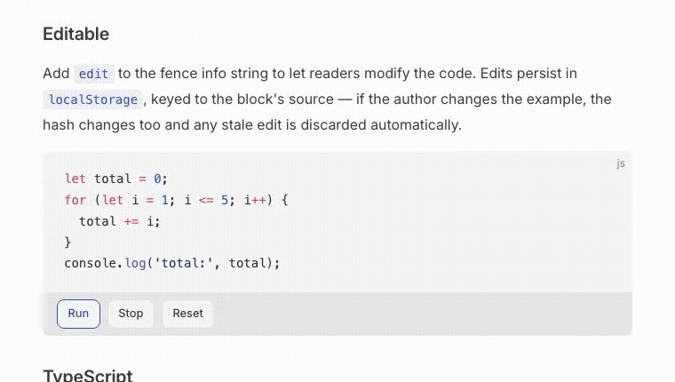

<picture>
  <source media="(prefers-color-scheme: dark)" srcset="./assets/logo-dark.svg">
  
</picture>

Lightweight, local-first runnable code snippets for sites that use [Shiki](https://shiki.style/).

Add `run` to a fenced code block; readers get a Run button and streamed console output. Everything executes in the reader's browser — no server, works offline after first load.

<p align="center">
  
</p>

**Status: early, but published.** The core (JS + TypeScript execution, editable blocks, VitePress + plain Astro integrations) works and is dogfooded on this repo's own docs site. See the [roadmap](./docs/roadmap.md) for what's done and what's next.

## How it works

- Authors write a normal fenced code block and add `run` (run-only) or `run edit` (editable) to the fence info string.
- At build time, a Shiki transformer stamps the block with its language, theme(s), and a source hash.
- At runtime, a module Web Worker executes the code's `textContent` — real `console.*` capture, top-level `await`, a timeout, and a Stop button via `worker.terminate()`.
- Output is console-only: no DOM/iframe rendering, so this fits logic and algorithm examples, not UI demos.
- `run edit` blocks persist reader edits to `localStorage`, keyed by the original source hash — if the author changes the snippet, the hash changes and stale reader edits are discarded automatically.

## Usage (VitePress)

```ts
// .vitepress/config.ts
import { defineConfig } from 'vitepress';
import { ugokuTransformer } from '@ugoku/vitepress';

export default defineConfig({
  markdown: {
    codeTransformers: [ugokuTransformer()],
  },
});
```

```ts
// .vitepress/theme/index.ts
import DefaultTheme from 'vitepress/theme';
import { setupVitePressMount } from '@ugoku/vitepress/client';

export default {
  extends: DefaultTheme,
  enhanceApp({ router }) {
    setupVitePressMount(router);
  },
};
```

Then in a markdown file:

````md
```js run
console.log('hello');
```

```ts run edit
function add(a: number, b: number): number {
  return a + b;
}
console.log(add(2, 3));
```
````

VitePress and plain Astro are supported today — see [`@ugoku/astro`](./packages/astro/README.md) for the Astro setup. Astro Starlight support is separate, harder work and comes later (see the [roadmap](./docs/roadmap.md)).

## Languages

- **JavaScript** — runs as-is.
- **TypeScript** — type annotations are stripped in the browser via [Sucrase](https://github.com/alangpierce/sucrase) before execution. No type-checking; this only removes syntax that isn't valid JS.

## Packages

| Package | Purpose |
| --- | --- |
| [`@ugoku/core`](./packages/core/README.md) | Runtime: worker runner, output panel, console serializer, edit overlay, TS stripping |
| [`@ugoku/shiki`](./packages/shiki/README.md) | The build-time Shiki transformer |
| [`@ugoku/vitepress`](./packages/vitepress/README.md) | VitePress adapter (transformer wiring + SPA route-change mount) |
| [`@ugoku/astro`](./packages/astro/README.md) | Plain Astro adapter (single auto-wiring integration) |
| `docs/` | The VitePress dogfood site — every runnable example doubles as an e2e test case |

## Contributing

No required process or tooling — use whatever workflow you like. `specs/` and `.superpowers/` are gitignored intentionally (local planning/scratch, not project content).
